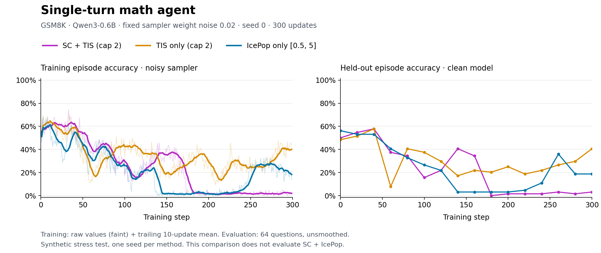
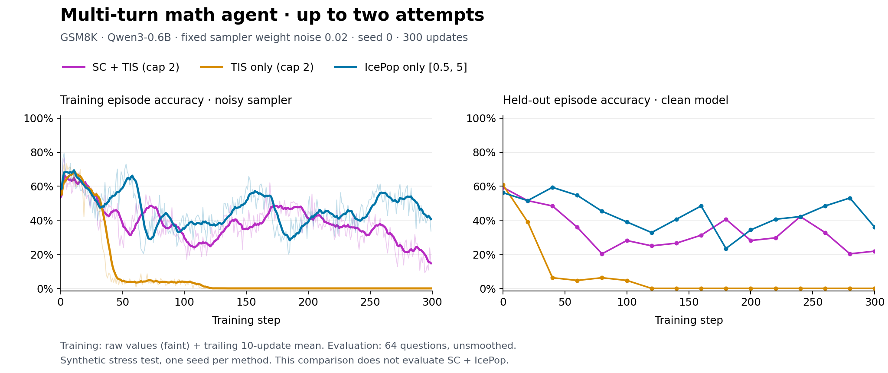

# Score centering for multi-turn and text-only agents

Score centering (SC) can collect SGLang sampler heads through `MultiTurnWorkflow`,
`ArealOpenAI` Chat Completions and Responses, and AReaL's OpenAI proxy. Text tool calls
use the existing tool parser and agent loop. Both individual-turn and concatenated
training exports carry the original sampler probabilities. The FSDP and Megatron
training paths use the same SC calculation and optional token-level TIS.

## Configuration

Use the existing settings; no extra dependency or new YAML field is needed:

```yaml
actor:
  use_score_centering: true
  recompute_logprob: false
  use_decoupled_loss: false
  rejection_sampling:
    level: token
    metric: ratio
    action: clamp
    upper: 2.0
    lower: null

gconfig:
  score_centering_top_k: 128
  temperature: 1.0
  greedy: false
  top_p: 1.0
  top_k: -1
  frequency_penalty: 0.0
```

Set `actor.rejection_sampling=null` for SC without TIS. The `top_k` sampling option
remains untruncated; `score_centering_top_k` controls only how many sampler
probabilities are collected. Use the same head width for every training request.

The math entry point forwards `gconfig.score_centering_top_k` to its agent. The
multi-turn math example forwards it through `gconfig.to_openai_args_dict()`. Both
examples disable head collection in their evaluation configurations, which use a
different temperature. Apply the settings above to the existing math or multi-turn math
YAML and use its normal launcher and resource allocation.

For a custom text agent, forward the extension on **every** model request:

```python
response = await client.chat.completions.create(
    model="default",
    messages=messages,
    temperature=1.0,
    top_p=1.0,
    tools=tools,
    extra_body={"score_centering_top_k": 128},
)
```

Here `client` is `ArealOpenAI`, or the standard OpenAI client connected to AReaL's proxy
backed by native SGLang. The same extension works with `responses.create`.
`GenerationHyperparameters.to_openai_args_dict()` and the Responses/Agents conversion
helpers add it automatically. The standard OpenAI response schema does not change; AReaL
retains sampler heads internally for training.

## Turn and tool alignment

Each generated token retains its raw token ID, sampled log-probability, sampler head and
rollout weight version. Parsing a tool call or removing stop tokens from displayed text
does not change these training records. Tool results, feedback, prompt tokens and
inserted separators have zero loss mask and no sampler probability mass.

Individual export trains each response with its whole prompt masked. Concat export
preserves the parent's sampled token prefix and historical heads, then appends only the
new prompt gap and new sampled response. Retokenized or truncated parent prefixes,
missing heads and inconsistent head widths are rejected. Sequence padding cannot pad the
head-candidate dimension, including when combining separate rollout batches.

This support covers text inputs and ordinary unconstrained stochastic sampling at
temperature 1. Multimodal SC and grammar-constrained decoding are not supported. Tool
definitions may appear in prompts, and generated calls may be parsed and executed by the
agent; constraints that modify the sampling distribution are not supported. Existing
trainer restrictions, including tree-attention training and distillation, continue to
apply. This change does not add support to AReaL's v2 data proxy or to an external
inference provider that does not return native sampler heads.

## Regression checks

```bash
python -m pytest tests/test_score_centering_agentic.py \
  tests/experimental/openai/test_score_centering_proxy.py \
  tests/test_score_centering.py tests/test_score_centering_tis.py
```

The agentic tests cover both OpenAI APIs, individual/concat export, real text tool-call
parsing and tool replies, native retry turns, empty responses, repeated stop tokens,
streamed presentation, retry cleanup, proxy serialization and sampling validation. A
full-vocabulary oracle checks the SC/TIS gradient using exported historical heads.

## Synthetic sampler-mismatch stress test

These are **real training runs under a synthetic sampler-mismatch stress test**. The
fixed noise is an artificial perturbation, not a measurement of a typical production
sampler mismatch. The experiment tests behavior under that perturbation; it does not
establish general superiority or a production default.

Qwen3-0.6B is trained on GSM8K with a single-turn math agent or a multi-turn math agent
allowing up to two attempts total, with incorrect-answer feedback before the second
attempt. Training accuracy is binary episode success under the noisy sampler, including
successful retries for multi-turn. Clean evaluation uses unperturbed current weights on
64 held-out questions every 20 updates and after the final update. Compare methods
within each workflow; the two workflows have different retry and token budgets.

All six runs completed 300 updates with seed 0, 64 questions x 8 responses per update,
at most 1024 new tokens per turn, thinking disabled, and Megatron TP=CP=PP=1 with
SGLang. Adam uses learning rate `1.7e-5` and weight decay `0.017`. Binary correctness is
mapped to -1/+1 before within-prompt mean subtraction. All arms use REINFORCE, without
PPO clipping, normalized by the original generated-token count.

- **SC + TIS:** token-level importance weights capped at 2, with the top-128 SC
  correction.
- **TIS only:** the same weighting and logprob computation path, with only the SC
  correction zeroed.
- **IcePop only:** retain the importance ratio inside `[0.5, 5]`, otherwise zero it; SC
  is disabled. This uses the native logprob path. Sampler heads are still collected for
  auditing.

The TIS pair isolates the SC correction. IcePop is an additional weighting baseline, not
an isolated SC ablation: both its weighting rule and logprob computation path differ.
**These runs do not evaluate SC + IcePop, and this PR does not add that combination.**

A fixed Gaussian perturbation is created once from the initial weights:
`delta = 0.02 * initial_weights * Normal(0, 1)`. After each trainer update, the sampler
loads current weights plus that same perturbation. Noise is seeded per parameter, shared
by tied embeddings/output weights and stored in BF16. Trainer and evaluation weights
remain unperturbed. Within each workflow, methods share the data schedule, model,
optimizer, seed and perturbation construction; independently sampled trajectories
diverge during training.





Faint training lines show every recorded update; bold lines show a trailing 10-update
mean. Evaluation points are unsmoothed. All figures use the same 0–100% accuracy scale;
no confidence intervals are implied.

| Workflow                        | Method                 | Mean training accuracy, steps 280–299 | Clean evaluation, step 300 |
| ------------------------------- | ---------------------- | ------------------------------------: | -------------------------: |
| Single-turn                     | SC + TIS (cap 2)       |                                  2.2% |                       3.1% |
| Single-turn                     | TIS only (cap 2)       |                                 40.7% |                      40.6% |
| Single-turn                     | IcePop only \[0.5, 5\] |                                 20.4% |                      18.8% |
| Multi-turn (up to two attempts) | SC + TIS (cap 2)       |                                 19.1% |                      21.9% |
| Multi-turn (up to two attempts) | TIS only (cap 2)       |                                  0.0% |                       0.0% |
| Multi-turn (up to two attempts) | IcePop only \[0.5, 5\] |                                 44.6% |                      35.9% |

**Results are mixed.** SC + TIS retains more reward than TIS-only in multi-turn, but
falls to near-zero accuracy and finishes substantially worse in single-turn. IcePop-only
finishes ahead of SC + TIS in both workflows, while TIS-only finishes ahead of IcePop in
single-turn. Single-turn IcePop also passes through a near-zero interval before
recovering, so endpoint rankings do not describe the entire trajectory. The table uses
the same final 20 training updates for every run; its training means are distinct from
the final clean-model evaluation.

The reason for the different rankings is **not established by these runs**. Score
centering targets expected-score drift under the sampling distribution; that property
does not guarantee better task reward than every weighting rule. One seed, differing
trajectories, and the change of weighting and logprob path in the IcePop baseline
prevent attributing the gap to a single cause. The top-128 tail approximation is another
limitation; these results do not establish it as the cause of the single-turn collapse.

All six runs also show heavy late response truncation: over the final 20 updates, the
fraction of episodes whose final model response ended at the length limit exceeds 99% in
every arm. Retained verifier reward therefore must not be read as healthy generation or
general training stability. These curves provide behavior evidence for the integration,
alongside separate functional and gradient tests. They do not prove universal
performance gains, measure text-tool task learning, or support a throughput claim.

The sanitized [single-turn metrics](score_centering_agentic_single_results.json) and
[multi-turn metrics](score_centering_agentic_multiturn_results.json) include the setup,
raw per-step values and summary calculations, without account links or deployment paths.
All 300 training-accuracy values in every run were checked against the experiment
tracking history and matched exactly. Learning runs used the feature implementation
before its upstream rebase/merge; PR-tree regression validation is separate.
