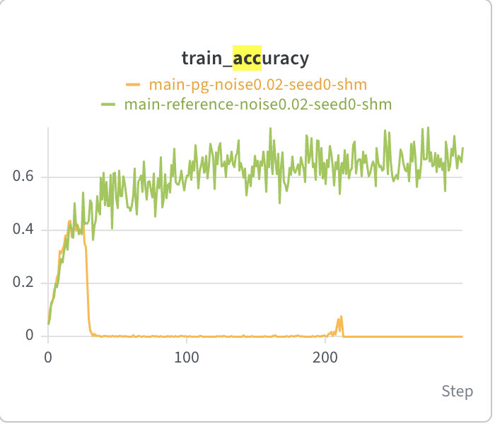

# Score centering: Countdown validation

This feature implements head/tail score centering with ordinary PyTorch autograd, using
sampler probabilities returned by native SGLang generation. It adds no custom backward,
kernel, or dependency, and makes no throughput claim.

## Paper-style experiment

We repeated the fixed-weight-noise Countdown experiment from
[Score Centering Stabilizes Off-policy Reinforcement Learning](https://arxiv.org/abs/2609.20807),
comparing uncorrected REINFORCE with reference score centering. The task generator,
prompt, reward checker, and experiment settings were taken from the
[authors' reference implementation](https://github.com/martin-marek/score-centering/tree/64842967077ea105470ca73fc5d714366d3f7bdb).

| Setting        | Value                                                               |
| -------------- | ------------------------------------------------------------------- |
| Model          | Qwen3-0.6B                                                          |
| Task           | Countdown: use four supplied numbers exactly once to reach a target |
| Dataset        | 20,000 generated problems; shuffled per seed, first 64 held out     |
| Training batch | 64 prompts × 8 responses                                            |
| Sequence limit | 512 tokens including prompt                                         |
| Sampling       | Temperature 1, untruncated; sampler head size 128                   |
| Reward         | ±1, subtract within-prompt group mean, no std normalization         |
| Optimizer      | SGD, constant LR 0.01; no weight decay or gradient clipping         |
| Budget         | 300 updates, one optimizer step per batch                           |
| Evaluation     | Clean model, 64 held-out prompts × 8 responses, every 20 updates    |

At initialization, we sample a fixed perturbation
`delta = 0.02 * initial_weights * Normal(0, 1)`. After each update the sampler receives
`current_weights + delta`; evaluation receives clean current weights. The same
perturbation is reused throughout each run. Noise scale 0.02 is not a 2% probability of
corrupting a token or a 2% perturbation of every weight.

## Observed results

The following completed runs were retrieved from W&B on 2026-10-22. The reported metric
is mean **clean held-out accuracy** at updates 260, 280, and 300. Runs use the same
dataset split within each seed; seeds have different held-out splits.

| Noise       | Seed | Plain PG | Reference SC |
| ----------- | ---- | -------- | ------------ |
| 0.02        | 0    | 0.00%    | 61.07%       |
| 0.02        | 1    | 0.00%    | 67.71%       |
| 0 (control) | 0    | 60.55%   | 62.37%       |

The user-provided W&B graph below shows **training accuracy for seed 0**, rather than
the held-out metric in the table. PG collapses early; reference SC continues learning.
Clean evaluation confirms the deterioration is not confined to noisy training
generations.

This supports the paper's qualitative stability finding for this configuration in two
completed seeds. The remaining sweep was still in progress when these results were
collected. This is not a full reproduction of all paper experiments or evidence of
universal stability across noise levels, models, or platforms.

## Implementation verification and limits

The learning runs used AReaL v2.1.0 plus our SGLang SC integration, with the reference
arm computing ordinary checkpointed PyTorch log-softmax/gather. The PR ports that
reference calculation and integration to current upstream AReaL; the 300-step runs were
not rerun on the rebased source.

Tests compare values and gradients against an independent dense formulation, including
full-support/zero-tail cases, duplicate selected IDs, BF16 inputs,
hidden-state/output-weight gradients, an optimizer update, and padded actor/FSDP
alignment. Transport tests cover sampler heads and interrupted generations.

Our stack differs from the paper's JAX stack: it uses PyTorch/FSDP, SGLang BF16 serving,
and Torch random-number streams. Dynamic batching can produce different trajectories
despite matched request seeds. The surrogate omits a fully detached constant from the
paper's loss, preserving gradients but changing scalar loss values. Sampling is
synchronized each update except for the intentional fixed weight perturbation; this does
not reproduce the paper's staleness or quantization experiments.
