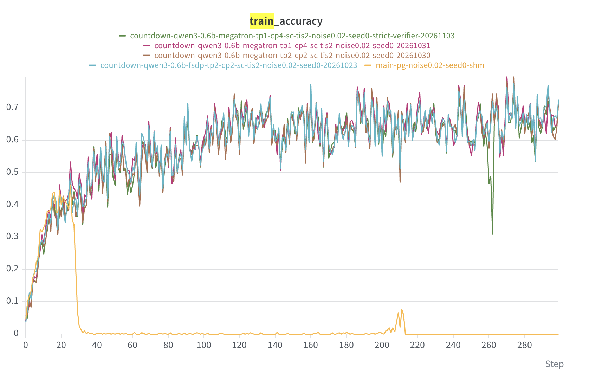

# Score centering with Megatron

Megatron uses the same head/tail score-centering (SC) calculation and optional
token-level truncated importance sampling (TIS) as FSDP. Native SGLang rollout supplies
the sampler head token IDs and log-probabilities. No new configuration fields,
dependencies or SGLang patches are required.

## Implementation

The engine computes sampled log-probabilities and the SC correction from ordinary packed
logits on the last pipeline stage. Tensor parallelism (TP) normalizes across vocabulary
shards without gathering full-vocabulary logits. Context parallelism (CP) splits sampler
heads with the packed tokens, then differentiably reassembles and unpads token scalars
before the existing actor loss. Pipeline parallelism (PP) uses Megatron's existing
backward schedule and optimizer normalization, including per-token loss mode.

Enable `actor.use_score_centering=true` with `actor.recompute_logprob=false`; choose
`actor.rejection_sampling=null` for unweighted scores or the existing token-level ratio
clamp for TIS. The [math example](README.md#score-centering-with-sglang) lists all
rollout requirements. For example, `megatron:d1t2c2p2` uses eight trainer GPUs. Rollout
resources are separate. Megatron vocabulary padding is excluded from SC normalization.

Full local logits remain live; this is a backend support change with no performance
claim. Tree training, distillation, chunked LM-head loss, MTP training and
differentiable entropy are unsupported. Multi-node, NPU, MoE, virtual-pipeline and
multimodal SC execution have not been validated.

## Countdown experiment with the corrected verifier

We repeated the fixed sampler-weight-noise Countdown setting from
[Score Centering Stabilizes Off-policy Reinforcement Learning](https://arxiv.org/abs/2609.20807),
using the setup described in the
[earlier validation notes](score_centering_countdown.md). The Megatron rerun uses the
strict arithmetic parser merged in
[AReaL #1876](https://github.com/areal-project/AReaL/pull/1876).

| Setting              | Value                                                                        |
| -------------------- | ---------------------------------------------------------------------------- |
| Model and task       | Qwen3-0.6B; Countdown                                                        |
| Trainer layout       | TP=1, CP=4, PP=1                                                             |
| Correction           | SC head size 128; token-level TIS cap 2                                      |
| Sampler perturbation | Fixed `0.02 * initial_weights * Normal(0, 1)` added after each weight update |
| Sampling             | Temperature 1; no truncation                                                 |
| Training             | 64 prompts × 8 responses per update; 300 updates; seed 0                     |
| Optimizer            | SGD, learning rate 0.01; no momentum, weight decay or gradient clipping      |
| Sequence limit       | 512 tokens including prompt                                                  |
| Reward               | Binary correctness, mapped to −1/+1 before within-prompt mean subtraction    |
| Evaluation           | Clean weights; 64 held-out prompts × 8 responses, every 20 updates           |



The green curve is the corrected-verifier Megatron CP=4 run. Magenta is the previous
CP=4 run; brown is Megatron TP=2/CP=2; cyan is FSDP TP=2/CP=2. These four runs use SC
and TIS. The orange `main-pg` curve is the REINFORCE baseline without SC or TIS. It is
qualitative context, not an ablation isolating SC from TIS or distributed layout. The
supplied plot is reproduced unchanged. Accuracy is the fraction of correct training
responses per update; it is not held-out accuracy.

Both CP=4 runs completed 300 successful updates with finite gradients. Their dataset,
engine source and SC source hashes match. The corrected run retained the paper-style
answer extraction, numerical tolerance and binary reward; it did not adopt the math
example's partial credit for answer formatting.

| CP=4 metric                             | Previous verifier | Corrected verifier |
| --------------------------------------- | ----------------- | ------------------ |
| Final training accuracy                 | 72.07%            | 71.88%             |
| Mean training accuracy, last 50 updates | 66.39%            | 63.60%             |
| Final clean held-out accuracy           | 61.33%            | 62.89%             |

The corrected run still learns, with a temporary late dip followed by recovery. These
are separate single-seed runs, so neither the plot nor the table establishes identical
trajectories, statistical equivalence or an improvement from changing the verifier.

### Why the verifier fix preserves this validation result

The strict verifier determined every training reward in the rerun. A bounded,
non-executing diagnostic implementing the previous scoring rules scored the same
responses for comparison. It recorded **zero disagreements across 153,600 training
responses and 8,192 evaluation responses**. Thus the corrected rules did not alter the
rewards or resulting within-prompt advantages for any response collected in this run.
The diagnostic was never used to select the training reward.

SC corrects the policy score using trainer and sampler probabilities; its formula does
not depend on the arithmetic verifier. The learning result does depend on rewards, so
formula independence alone would not rule out reward hacking. The dual-scoring audit and
successful strict-verifier rerun supply that missing check for this configuration: the
observed learning trend persists without rewarding the verifier loophole.

This does not imply verifier changes are harmless in general, nor that every response
from earlier runs has been rescored. The historical comparison supports the qualitative
stability observation for SC plus TIS at noise 0.02. It does not separately establish
SC's contribution relative to TIS or reproduce the paper's full sweep.

## Regression tests

The new tests exercise Megatron configuration guards, loss-hook and transport-dummy
behavior, CP sampler-head alignment, head-free ordinary forwards, and composition with
stale-token masking. Distributed tests compare losses, local-logit gradients and Adam
updates to those logits against a dense oracle, including TP=2, CP=2, CP=4, TP=2/CP=2,
uneven packed sequences, inactive partitions and native per-token normalization.
Existing shared SC/TIS tests cover hidden-state and output-projection gradients.

```bash
python -m pytest tests/test_score_centering.py tests/test_score_centering_tis.py \
  tests/test_score_centering_vocab_parallel.py tests/test_score_centering_parallel.py \
  tests/test_score_centering_megatron.py -q
```

Real-model tests use a local Qwen3 checkpoint and perform ordinary forwards plus one
actual optimizer update. Their layouts include TP=2, CP=4, PP=2 and TP=2/CP=2/PP=2, with
and without TIS across the test matrix. No model or dataset is downloaded:

```bash
AREAL_TEST_MODEL=/path/to/local/qwen3-checkpoint python -m pytest \
  tests/test_score_centering_megatron.py -k local_checkpoint -q
```

The largest case requires eight CUDA devices. Checkpoint tests skip explicitly when the
checkpoint or sufficient devices are unavailable. The 300-update experiment above was
run on the experimental implementation before this port onto current main; it is
separate from the PR branch's regression tests.
