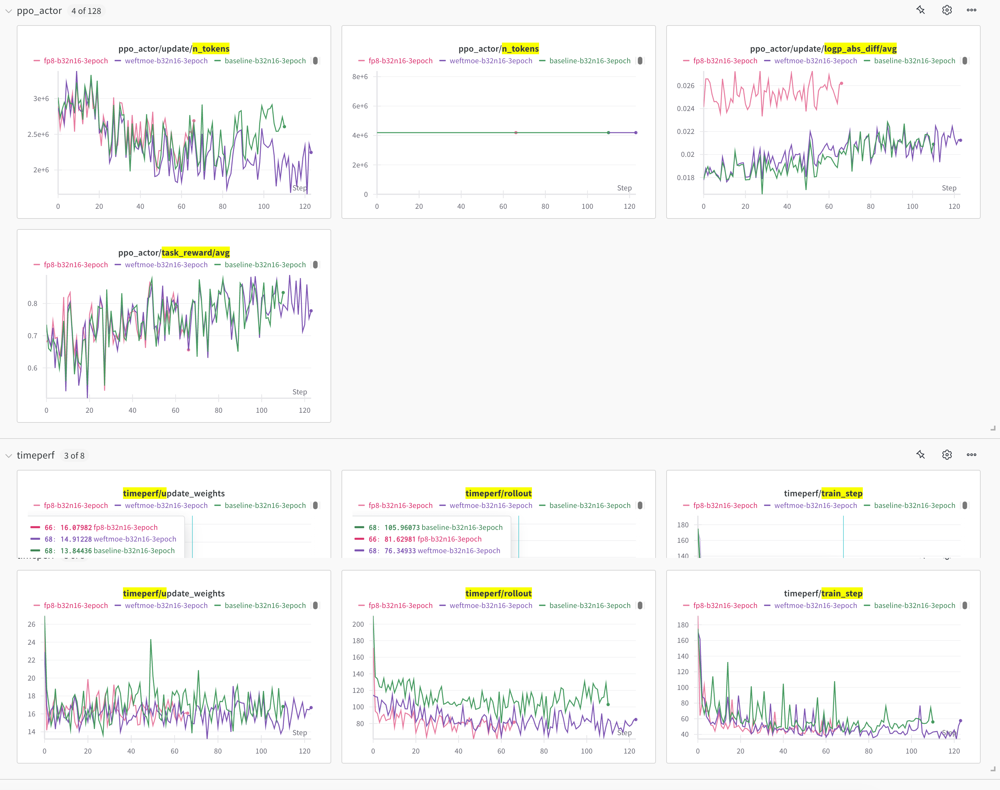
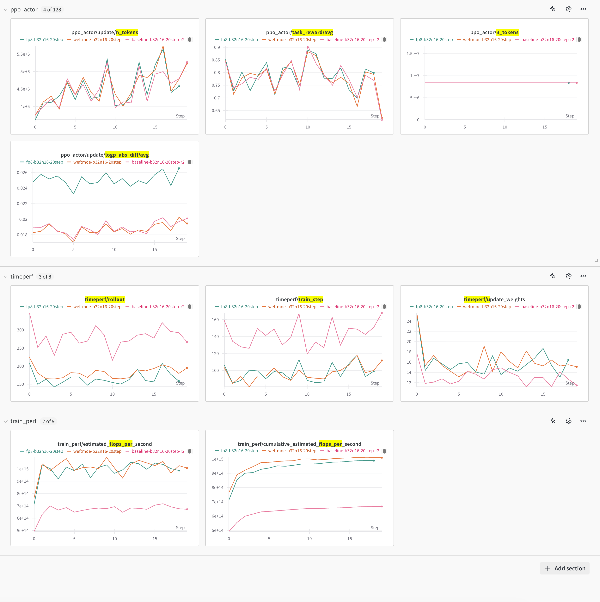
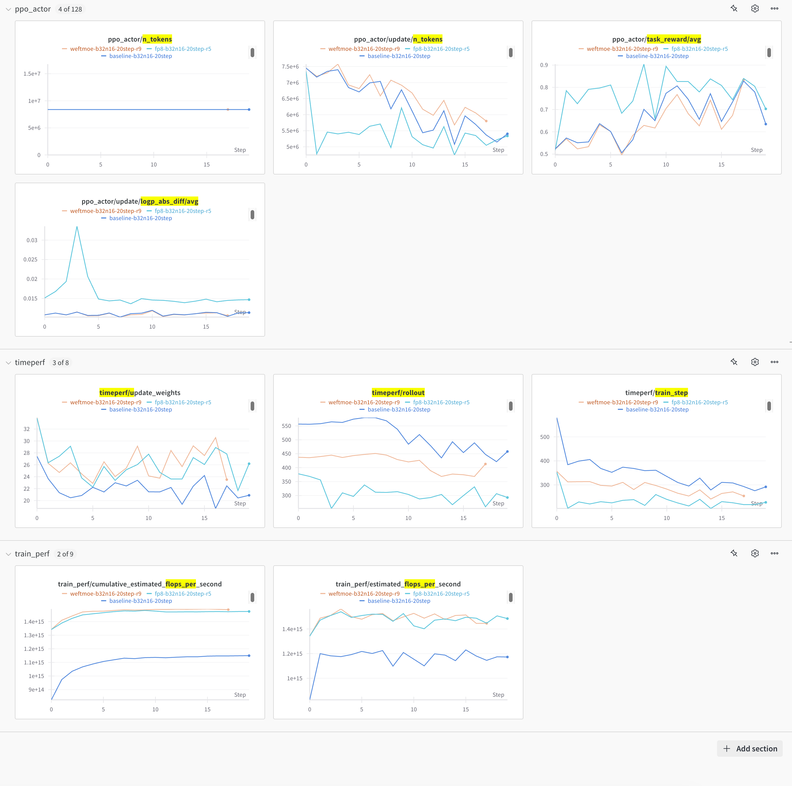

# WeftMoE with AReaL

[WeftMoE](https://github.com/yulangz/WeftMoE) replaces the routed experts in Megatron
training and SGLang prefill/decode. Routers, shared experts, attention, and the RL
algorithm remain in their existing engines. The optional integration is enabled with
`AREAL_USE_WEFTMOE=1` in **both** actor and rollout workers; `WEFTMOE_FP8=1` selects
blockwise FP8 routed-expert computation.

## Requirements

- Hopper/SM90a GPUs and a WeftMoE native extension built for the model's expert
  dimensions. Follow the upstream
  [build instructions](https://github.com/yulangz/WeftMoE/blob/main/docs/usage.md). All
  workers must import the same WeftMoE package and load the matching extension.
- AReaL CPU-staged AdamW with distributed and precision-aware optimization, plus
  [WeftMoE staged-AdamW support](https://github.com/yulangz/WeftMoE/pull/7). This path
  uses complete, locally owned expert matrices: expert DP=1 and expert TP=1. This
  integration does not require the separate Muon optimizer PR.
- The tests attached to the integration PR used PyTorch 2.9.1+cu129, SGLang
  0.5.10.post1, AWEX 0.9.0, and Megatron-Core 0.19.0. WeftMoE's FP8/TMS allocation
  compatibility requires PyTorch 2.9.x on this path.
- A configured eight-GPU Ray node, a shared experiment directory, model weights, and a
  local prompt-deduplicated DAPO-Math-17k dataset. Set machine-specific network and
  library environment in your worker configuration; no cluster addresses are embedded
  here.

## Run

From the AReaL repository root, after preparing the environment:

Use the prompt-deduplicated
[YouJiacheng/DAPO-Math-17k-dedup](https://huggingface.co/datasets/YouJiacheng/DAPO-Math-17k-dedup)
train set (17,398 rows). Download it once before starting the job, into a directory
visible to every worker:

```bash
export DAPO_MATH_17K_PATH=/path/to/DAPO-Math-17k-dedup
hf download YouJiacheng/DAPO-Math-17k-dedup \
  distinct-prompts-with-rewards.parquet --repo-type dataset \
  --revision 6e26a33abdabd3e6aaa1d742326b790758f7dbc5 \
  --local-dir "$DAPO_MATH_17K_PATH/data"
```

The `data/` directory is required by the existing DAPO loader. Without an environment
override, the recipe uses `./datasets/DAPO-Math-17k-dedup`. The original repeated export
contains about 1.79 million rows; its per-row prompt-length filtering can exceed
data-registration RPC timeouts. The deduplicated dataset keeps the existing
prompt/reward schema, and the normal tokenizer length filter remains enabled. Do not
point the recipe at the repeated export. Deduplication changes the number and sampling
frequency of examples in an epoch; use the same prepared dataset for all comparison
runs.

```bash
export WEFTMOE_MODEL_PATH=/path/to/Qwen3.5-35B-A3B-Base
export DAPO_MATH_17K_PATH=/path/to/DAPO-Math-17k-dedup
export AREAL_FILEROOT=/path/to/experiments
export WEFTMOE_TENSOR_EXTENSION=/path/to/model-matched/_runtime.so
export RAY_ADDRESS=auto

bash examples/weftmoe/run.sh bf16
bash examples/weftmoe/run.sh fp8
bash examples/weftmoe/run.sh baseline
```

The script invokes the existing DAPO-Math training entrypoint. The baseline disables
WeftMoE in both engines and selects Megatron Flex/DeepEP. The YAML explicitly propagates
the WeftMoE flags and extension path to both sets of workers. Install WeftMoE and its
shared libraries in the worker environment as well as the driver. W&B is disabled by
default; configure it through the normal AReaL logger options.

The launcher generates a random `AREAL_PROXY_ADMIN_API_KEY` when it is unset, empty, or
still the public `areal-admin-key` default. An explicitly configured custom key is
preserved. The resolved configuration supplies the same key to the remote proxy and its
clients; do not pass credentials as command-line overrides. This avoids the proxy's
rejection of a default admin key on a non-localhost bind address.

The default recipe uses Qwen3.5-35B-A3B-Base, 32 prompts × 16 completions, 16K
generation, a 16384-token training microbatch limit, and a 20-step cap. Training uses
TP2 × DP4, EP8, ETP1, full-layer recomputation, and BF16 model parameters with
CPU-staged AdamW. Rollout uses DP attention with DP8/EP8 on the same eight GPUs. Saver
and recovery checkpoint writes are disabled.

The recipe sets `actor.megatron.attention_backend=flash` before model construction to
avoid the cuDNN fused THD/GQA backward issue observed with Qwen3.5 on the tested stack.
SFT and RL training share this setting; keep `use_deterministic_algorithms=false` for
packed Qwen3.5/GDN training. The backend setting also accepts `auto`, `fused`, or
`unfused`; its default `null` preserves the bridge's selection. Explicit non-Flash
backends conflict with AReaL's deterministic mode and are rejected. This setting does
not select a FlashAttention generation or change SGLang rollout's separate
`attention_backend` setting.

AdamW FP8 publication consumes complete expert matrices from its GPU staging slot. Each
matrix must fit in `actor.megatron.cpu_staged_offload.bucket_size_mb`; oversized
matrices fail at binding. Expert-only BF16 parameter buffers are released while FP32
gradient buffers remain available. Checkpoint operations restore the original buffer
storage; closing the adapter also restores BF16 writeback and parameter sync. The
attached screenshots below use Muon, not this AdamW configuration.

For 8K generation and a 65536-token training microbatch limit:

```bash
bash examples/weftmoe/run.sh bf16 \
  gconfig.max_tokens=8191 gconfig.max_new_tokens=8192 \
  sglang.context_length=8208 actor.mb_spec.max_tokens_per_mb=65536 \
  total_train_steps=null total_train_epochs=3
```

The server context includes headroom for resuming generation: the SGLang version used
here limits inputs to at most `context_length - 6`, while a resumed request includes the
prompt and partial completion. Keep `gconfig.max_tokens` as the prompt-plus-completion
budget; the extra server context does not increase that budget or the training
microbatch limit. The 16-token headroom is conservative, not an MTP draft-token
requirement.

For Qwen3.5-122B-A10B, set `WEFTMOE_MODEL_PATH` to that model and use an extension built
with WeftMoE's `qwen122b` profile. It is a different checkpoint from the 35B Base model.
Do not reuse the 35B native binary for 122B.

## Muon 8K sampling-mask comparison

`dapo_math_grpo_muon_8k.yaml` uses BF16 WeftMoE, staged Muon, a 65536-token training
microbatch limit, 32 prompts × 16 completions, and three epochs without a step cap.
Recovery and periodic checkpoint writes are disabled. Set `DAPO_MATH_17K_PATH` to the
exact baseline dataset; do not change its row multiplicity for an epoch comparison. Both
arms use temperature 1, top-p 0.95, and top-k 30. This intentionally differs from the
older untruncated sampler.

After configuring the worker environment as above, run each arm on its own node:

```bash
python examples/weftmoe/dapo_math_sampling_mask.py \
  --config examples/weftmoe/dapo_math_grpo_muon_8k.yaml \
  trial_name=baseline sampling_mask_transfer=false
python examples/weftmoe/dapo_math_sampling_mask.py \
  --config examples/weftmoe/dapo_math_grpo_muon_8k.yaml \
  trial_name=mask-on sampling_mask_transfer=true
```

Both arms use the OpenAI MathAgent workflow, with top-k explicitly forwarded in the HTTP
request body and the historical gold-first `verify(gold, prediction)` reward convention.
The proxy exports sampling-mask references when enabled. The recipe retains Flash
attention and 16 tokens of server context headroom for the compatibility reasons
described above; the generation budget remains 8191 tokens. Credentials, Ray addresses,
native extension paths, and library paths belong in the deployment environment, not this
recipe.

`train_perf/estimated_tflops_per_second_per_gpu` reports effective training TFLOPs/s per
GPU: the existing group FLOPs/s divided by the total number of training ranks and by
1e12. The cumulative counterpart is a ratio of cumulative work and time, not an average
of step rates. Neither metric measures hardware peak utilization or counts recomputation
as useful work.

## Ray worker file-descriptor limits

The 32 × 16 rollout batch creates 512 completions and can exceed low process
file-descriptor limits (`Too many open files`). Check the actual AReaL RPC,
rollout/proxy, and relevant Ray worker processes on every node:

```bash
worker_pid=<actual-worker-pid>
prlimit --pid "$worker_pid" --nofile
cat "/proc/$worker_pid/limits"
```

Checking `ulimit -n` only in the submission shell is insufficient: an already-running
Ray service and its children retain their own limits. Set adequate soft and hard limits
in the service/container or shell that starts Ray on each node, and verify the new
workers after a planned restart. Raising the hard limit may require administrator
privileges. The tested workaround used 1048576 for both limits; this is not a measured
minimum requirement.

For the AReaL workers, the example can also be launched with an explicit limit:

```bash
bash examples/weftmoe/run.sh bf16 \
  'actor.scheduling_spec.0.cmd="prlimit --nofile=1048576:1048576 -- python3 -m areal.infra.rpc.rpc_server"' \
  'rollout.scheduling_spec.0.cmd="prlimit --nofile=1048576:1048576 -- python3 -m areal.infra.rpc.rpc_server"'
```

This requires `prlimit` and sufficient permissions on the worker hosts. The inner
`python3` must resolve to the intended AReaL environment on each worker; replace it with
that environment's absolute interpreter path if needed. Wrapping the command in
`prlimit` bypasses the scheduler's usual leading-Python interpreter replacement. The
limit applies to new RPC servers and their children, not existing Ray processes. Recheck
the actual worker limits after startup; increasing only the driver limit does not fix an
existing worker's limit.

## Integration boundaries

This recipe supports the v1 `PPOTrainer` colocated AWEX path. It does not enable WeftMoE
FP8 in the v2 service or DTE weight-update paths.

The Megatron adapter is installed before training, invalidated after optimizer updates,
suspended before memory offload, and closed at engine teardown. Checkpoint operations
materialize BF16 weights from FP32 masters when needed.

In FP8 mode, the staged optimizer writes W and W-transpose directly from its FP32
staging slot. AWEX sends W bytes and FP32 block scales using its existing canonical
parameter mapping; it does not send W-transpose. SGLang rebuilds its receive views after
memory restoration and commits the new version after the transfer. The AWEX package and
transport protocol are unchanged.

BF16 offload also handles expert parameters without DDP flat parameter buffers. An
optimizer can expose complete CPU FP32 masters through
`get_full_parameter_master(param)` to restore unaliased expert allocations after
`drain()`. Without this optional interface, non-flat allocations retain a
byte-preserving host copy. Optimizer work completes before storage is released. FP8
master publication waits for the quantization streams in WeftMoE.

## Attached experiment screenshots

The screenshots below were supplied from the recorded portions of the existing RL runs.
They are not new runs of the rebased PR branch. They show token counters, task reward,
update log-probability differences, and rollout/training/weight-update timers; the 16K
screenshots also show estimated training FLOPs/s.

All three comparisons use DAPO-Math-17k (train split), GRPO, 32 prompts × 16
completions, temperature 1.0, top-p 1.0, and Muon CPU offload with learning rate 1e-6.
Each run uses one node with 8× NVIDIA L20X (SM90, approximately 140 GiB/card). Training
topology is TP2 × DP4, EP8, ETP1, CP1, PP1, with full-layer recomputation. There is no
speculative decoding or MTP training. `baseline` uses native Megatron Flex/DeepEP and
native SGLang MoE; the other two curves use WeftMoE BF16 or FP8.

| Screenshot | Model                        | Generation total-token cap | Training microbatch token limit | Configured duration                 | Rollout attention / experts                                                     |
| ---------- | ---------------------------- | -------------------------- | ------------------------------- | ----------------------------------- | ------------------------------------------------------------------------------- |
| 35B, 8K    | Qwen3.5-35B-A3B-Base         | 8191                       | 65536                           | 3 epochs; stopped before completion | All three: DP8/EP8, DP attention on                                             |
| 35B, 16K   | Qwen3.5-35B-A3B-Base         | 16383                      | 16384                           | 20 steps                            | Baseline: TP8/EP8, DP attention off; WeftMoE BF16/FP8: DP8/EP8, DP attention on |
| 122B, 16K  | Qwen3.5-122B-A10B (non-Base) | 16383                      | 16384                           | 20 steps                            | All three: DP8/EP8, DP attention on                                             |

### Qwen3.5-35B-A3B-Base, 8K

Green: baseline; purple: WeftMoE BF16; pink: WeftMoE FP8. The three curves show 111,
124, and 67 completed steps, respectively; the configured three epochs did not finish.
SGLang context length was 8192 in these runs.



### Qwen3.5-35B-A3B-Base, 16K

Pink: baseline; orange: WeftMoE BF16; green: WeftMoE FP8. SGLang context length was
16384\. Baseline uses TP attention; the two WeftMoE runs use DP attention.



### Qwen3.5-122B-A10B, 16K

Blue: baseline; light yellow/orange: WeftMoE BF16; light blue: WeftMoE FP8. SGLang
context length was 16384, with DP attention enabled for all three runs.


